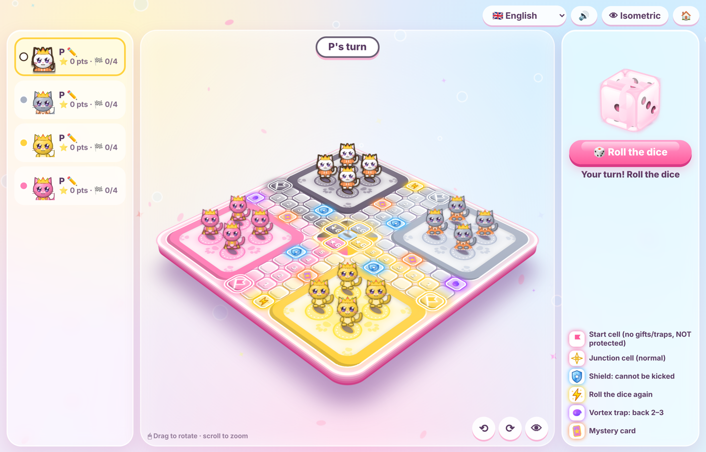
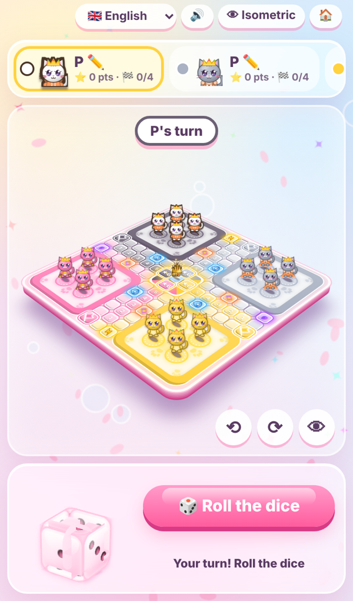

# 🐱 GEM-CA – Cờ Cá Ngựa (mèo chibi)

Trò chơi **Cờ Cá Ngựa (Ludo) 3D** chạy hoàn toàn trong **một file HTML** (`index.html`) – không cần cài đặt, mở bằng trình duyệt là chơi.

| Máy tính | Điện thoại |
|---|---|
|  |  |

## ▶️ Cách chơi / chạy
- Mở `index.html` bằng trình duyệt (Chrome, Safari, Edge…), hoặc bật **GitHub Pages** (Settings → Pages → Source: *GitHub Actions*) để có link chơi trực tiếp.
- Hỗ trợ **iOS / Android**: bố cục tự co giãn, xúc xắc và nút tung luôn hiện.

## ✨ Tính năng
- 2–4 người, bot hoặc chơi online qua **mã phòng** (PeerJS / WebRTC).
- Tiếng Việt / English, đổi tên ngay trong game.
- Mèo chibi 4 màu, **tủ đồ** (màu lông, trang phục, mũ, kính, phụ kiện cổ) kiểu Art Toy.
- Bàn cờ 3D isometric: xoay bằng kéo/nút, 3 góc nhìn, zoom.
- Xúc xắc 3D vật lý (bay, xoay, nảy, dừng đúng mặt), vương miện vàng ở trung tâm.
- Ô đặc biệt: 🛡️ giáp, ⚡ tung thêm, 🌀 xoáy lùi, 🃏 thẻ bài bí ẩn; hiệu ứng pháo hoa khi thắng.

## 📜 Luật chơi
1. Tung **1 hoặc 6** để đưa quân ra khỏi chuồng; xúc xắc hiện bao nhiêu đi đúng bấy nhiêu ô.
2. Tung ra **1 hoặc 6** được đi tiếp (ba lần 6 liên tiếp thì mất lượt).
3. Mỗi ô chỉ chứa 1 quân, không được đi xuyên qua quân khác. Đáp vào quân địch thì đá về chuồng; nếu có giáp thì bị bật lại chỗ cũ.
4. Ô xuất phát **không** bất tử – quân đứng đó vẫn có thể bị đá.
5. Đi hết một vòng rồi vào đường về đích (ô 1–6); cần tung **đúng số** để vào ô ★6. Đưa cả 4 mèo về đích là thắng.

## 🗂️ Cấu trúc
```
index.html                    # toàn bộ game (HTML + CSS + JS)
docs/                         # ảnh minh hoạ
.github/workflows/pages.yml   # tự động deploy GitHub Pages
```
